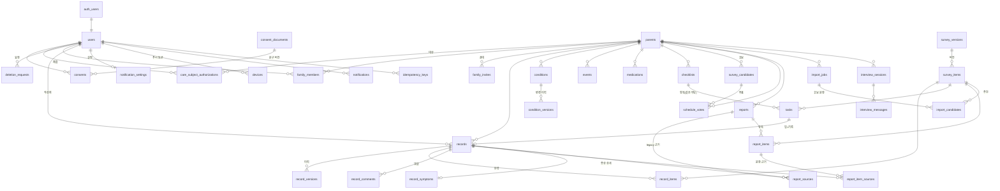

# 실버케어 ERD · 테이블 스키마

## 0. 테이블 지도 (도메인별, 35개)

| 도메인 | 테이블 |
| --- | --- |
| **인증·사용자** | users, consents, **consent_documents**, **care_subject_authorizations**, **deletion_requests** |
| **가족·권한** | parents, family_members, **family_invites** |
| **조사표 마스터** | survey_items, **survey_versions** |
| **기록(핵심)** | records, record_versions, record_items, **record_comments**, **record_symptoms**, **idempotency_keys** |
| **컨디션·사건·약** | conditions, **condition_versions**, events, medications |
| **체크리스트** | **checklists**, tasks |
| **조사일 투표** | schedule_votes, **survey_candidates** |
| **보고서(기록지)** | reports, report_sources(legacy), **report_items**, **report_item_sources** |
| **단톡방 가져오기** | **import_jobs**, **import_candidates** |
| **알림·기기** | **notifications**, **notification_settings**, **devices** |
| **인터뷰(P1)** | **interview_sessions**, **interview_messages** |

---

## 1. 전체 ERD (Mermaid)



---

## 2. 관계(Cardinality) 요약

| 부모 | 자식 | 관계 | 의미 |
| --- | --- | --- | --- |
| `auth.users` | `users` | 1 : 1 | Supabase Auth 가입, `users`는 앱 프로필(같은 id) |
| `consent_documents` | `consents` | 1 : N | 동의 문구 원문 ↔ 사용자 동의 |
| `users` ↔ `parents` | `family_members` | N : M | 형제 여럿이 한 부모님 공동 기록 |
| `survey_versions` | `survey_items` | 1 : N | 조사표 서식 버전 |
| `parents` | `records` | 1 : N | 한 부모님 기록 다수 |
| `records` | `record_items` | 1 : N | 한 기록 → 여러 52항목 |
| `records` | `record_versions`/`record_comments` | 1 : N | 이력/댓글 |
| `records` | `record_symptoms` | 1 : 1 | 증상 상세 |
| `conditions` | `condition_versions` | 1 : N | 변경 자동 감사 |
| `checklists` | `tasks` | 1 : N | 체크리스트 = task 묶음(같은 부모 강제) |
| `tasks` | `records` | 1 : 0..1 | 답=기록(같은 부모 강제), not_seen은 NULL |
| `survey_candidates` | `schedule_votes` | 1 : N | 후보 날짜 ↔ 투표 |
| `reports` | `report_items` | 1 : N | 보고서 ↔ 항목 |
| `report_items` | `report_item_sources` | 1 : N | 항목 ↔ 문장 단위 근거(교차부모 차단) |
| `reports` ↔ `records` | `report_sources`(legacy) | N : M | 과거 근거 매핑(보존) |
| `import_jobs` | `import_candidates` | 1 : N | 단톡방 후보(24h 만료) |
| `users` | `devices`/`notifications` | 1 : N | 푸시 토큰/알림 로그 |
| `interview_sessions` | `interview_messages` | 1 : N | 인터뷰 메시지(P1) |

---

## 3. 테이블별 스키마 (35개 전체 컬럼)

> 타입은 ENUM으로 고정. CHECK로 값 범위 검증. PK는 uuid(survey_items=text code, 복합 PK 테이블 별도 표기).
> 

### ─── 인증·사용자 ───

#### 3-1. `users` — 앱 사용자

| 컬럼 | 타입 | 제약 | 설명 |
| --- | --- | --- | --- |
| id | uuid | **PK**, FK→auth.users cascade | Auth와 공유 |
| login_type | login_type_enum | **nullable** | kakao/phone/email |
| phone | text |  |  |
| created_at | timestamptz | default now() |  |

#### 3-2. `consents` — 동의 이력 (POL-05)

| 컬럼 | 타입 | 제약 | 설명 |
| --- | --- | --- | --- |
| id | uuid | **PK** |  |
| user_id | uuid | FK→users cascade, not null |  |
| type | consent_type_enum | not null | service/privacy/health/noti |
| doc_version | text | not null | 동의 문구 버전 |
| agreed_at | timestamptz | default now() |  |
| revoked_at | timestamptz | CHECK ≥ agreed_at | 철회 시각 |

#### 3-3. `consent_documents` 🆕 — 동의 문구 원문

| 컬럼 | 타입 | 제약 | 설명 |
| --- | --- | --- | --- |
| id | uuid | **PK** |  |
| type | consent_type_enum | not null | service/privacy/health/noti |
| doc_version | text | not null, CHECK 비공백 |  |
| title / content | text | not null | 동의 제목·원문 |
| required | boolean | default true | 필수 동의 여부 |
| published_at | timestamptz | default now() |  |
| retired_at | timestamptz | CHECK ≥ published_at | 폐기 시각 |
|  |  | **unique(type, doc_version)** |  |

> ⚠️ 더미 법률 문구 삽입 금지. **검증된 실제 원문만** 발행.
> 

#### 3-4. `care_subject_authorizations` 🆕 — 돌봄 대상자 동의·대리권

| 컬럼 | 타입 | 제약 | 설명 |
| --- | --- | --- | --- |
| id | uuid | **PK** |  |
| parent_id | uuid | FK→parents cascade, not null |  |
| submitted_by | uuid | FK→users, not null | 제출 가족 |
| authorization_basis | text | not null | 대리 근거 |
| subject_or_representative | text | not null | 본인/대리인 |
| verification_status | text | CHECK pending/verified/rejected/revoked |  |
| verified_at / revoked_at | timestamptz |  |  |
| note | text |  |  |
| created_at | timestamptz | default now() |  |

> ⚠️ DB는 틀만. **실제 법적 처리 근거 검증은 FastAPI/법률 검토.**
> 

#### 3-5. `deletion_requests` 🆕 — 삭제 요청 흐름

| 컬럼 | 타입 | 제약 | 설명 |
| --- | --- | --- | --- |
| id | uuid | **PK** |  |
| requester_id | uuid | FK→users, not null |  |
| parent_id | uuid | FK→parents |  |
| request_type | text | CHECK account/consent_withdrawal/data_erasure/other |  |
| status | deletion_status_enum | default 'requested' | requested/reviewing/approved/rejected/completed |
| requested_at / reviewed_at / completed_at | timestamptz |  |  |
| resolution_note | text |  |  |

### ─── 가족·권한 ───

#### 3-6. `parents` — 돌봄 대상 (실명·주민번호 미수집, POL-07)

| 컬럼 | 타입 | 제약 | 설명 |
| --- | --- | --- | --- |
| id | uuid | **PK** |  |
| nickname | text | not null, CHECK 비공백 | 호칭만 |
| age_band | text |  | 60s~90s+ |
| apply_stage | apply_stage_enum | default 'before' | before/waiting/result/renewal |
| cohabiting | boolean | default false |  |
| survey_date | date |  | 조사일 |
| survey_scheduled_at | timestamptz | 🆕 | 조사 예정 일시 |
| judged_date | date |  | 판정일 |
| created_at | timestamptz | default now() |  |

#### 3-7. `family_members` — N:M 조인 + 권한

| 컬럼 | 타입 | 제약 | 설명 |
| --- | --- | --- | --- |
| id | uuid | **PK** |  |
| parent_id | uuid | FK→parents cascade, not null |  |
| user_id | uuid | FK→users cascade, not null |  |
| role | family_role_enum | default 'writer' | admin/writer/viewer |
| joined_at | timestamptz | default now() |  |
|  |  | **unique(parent_id, user_id)** | 중복 가입 방지 |

> ⚠️ FastAPI: 부모 생성+관리자 멤버는 한 트랜잭션, 마지막 admin 강등/탈퇴 금지.
> 

#### 3-8. `family_invites` 🆕 — 초대 링크

| 컬럼 | 타입 | 제약 | 설명 |
| --- | --- | --- | --- |
| id | uuid | **PK** |  |
| parent_id | uuid | FK→parents cascade, not null |  |
| invited_by | uuid | FK→users, not null |  |
| intended_role | family_role_enum | default 'writer' |  |
| token_hash | text | not null, **unique** | **원문 비밀 X, 해시만** |
| expires_at | timestamptz | CHECK > created_at | 7일 TTL(FastAPI) |
| accepted_by / accepted_at | uuid / timestamptz | CHECK 짝 일치 |  |
| revoked_at | timestamptz |  |  |
| created_at | timestamptz | default now() |  |

### ─── 조사표 마스터 ───

#### 3-9. `survey_items` — 52항목 마스터

| 컬럼 | 타입 | 제약 | 설명 |
| --- | --- | --- | --- |
| code | text | **PK** | phys_dressing 등 |
| area | area_enum | not null | physical/cognitive/behavior/nursing/rehab/uncat |
| label | text | not null | 조사표 항목명 |
| scale | scale_enum | not null | adl/yesno/motor/joint |
| sort_order | integer | not null, unique, CHECK 1~52 |  |
| family_checklist | boolean | default true | 재활 10개=false |
| survey_version_id | uuid | FK→survey_versions 🆕 | 서식 버전 |

#### 3-10. `survey_versions` 🆕 — 조사표 서식 버전

| 컬럼 | 타입 | 제약 | 설명 |
| --- | --- | --- | --- |
| id | uuid | **PK** |  |
| version | text | not null, **unique** | 현재 legacy-v0.5-unverified |
| effective_from / effective_to | date | CHECK to ≥ from | 유효 기간 |
| is_active | boolean | default false, **부분 unique(활성 1개)** |  |
| created_at | timestamptz | default now() |  |

### ─── 기록 (핵심) ───

#### 3-11. `records` — 모든 기록의 뿌리 🔒

| 컬럼 | 타입 | 제약 | 설명 |
| --- | --- | --- | --- |
| id | uuid | **PK**, unique(id, parent_id) | tasks/checklist 복합 FK 대상 |
| parent_id | uuid | FK→parents cascade, not null |  |
| author_id | uuid | FK→users, not null | 작성자(POL-04) |
| input_type | input_type_enum | not null | voice/text/symptom/kakao/checklist |
| source | record_source_enum | not null | direct/call/kakao(POL-04) |
| audio_path | text | 🔒 첫값후 잠금, CHECK 비공백 | 비공개 Storage 키 |
| audio_duration_seconds | integer | CHECK 0~180 🆕 | **음성 최대 3분** |
| original_text | text | 🔒 첫값후 잠금 | 원본 |
| current_text | text |  | 수정본 최신 |
| status | record_status_enum | default 'normal' | normal/excluded |
| processing_status | processing_status_enum | default 'pending' | pending/processing/completed/failed |
| recorded_at | timestamptz | 🔒 불변, not null, default now() 🆕 | **관찰/작성 시각** |
| occurred_at | timestamptz |  | 사건 발생 시각 |
| created_at | timestamptz | 🔒 불변, default now() | DB 저장 시각 |
| updated_at | timestamptz | 트리거 자동 갱신 |  |

**인덱스**: (parent_id, occurred_at desc) · (parent_id, created_at desc) · (parent_id, recorded_at desc, id desc) · author_id · (parent_id, status, processing_status)

#### 3-12. `record_versions` — 수정 이력

| 컬럼 | 타입 | 제약 | 설명 |
| --- | --- | --- | --- |
| id | uuid | **PK** |  |
| record_id | uuid | FK→records cascade, not null |  |
| text | text | not null | 그 시점 본문 |
| edited_by | uuid | FK→users, not null |  |
| edited_at | timestamptz | default now() |  |
| source_snapshot | record_source_enum | 🆕 | 출처 수정 이력 |
| item_codes_snapshot | text[] | 🆕 | 분류 수정 이력 |
| occurred_at_snapshot | timestamptz | 🆕 | 관찰시각 수정 이력 |

> ⚠️ FastAPI: current_text PATCH 시 이전 버전 INSERT + records UPDATE를 한 트랜잭션.
> 

#### 3-13. `record_items` — 기록→52항목 분류 (집계 핵심)

| 컬럼 | 타입 | 제약 | 설명 |
| --- | --- | --- | --- |
| id | uuid | **PK** |  |
| record_id | uuid | FK→records cascade, not null |  |
| item_code | text | FK→survey_items, not null |  |
| confidence | real | CHECK 0~1 | AI 확신도 |
| set_by | set_by_enum | default 'ai' | ai/user |
|  |  | **unique(record_id, item_code)** | 중복 분류 방지 |

#### 3-14. `record_comments` 🆕 — 기록 댓글

| 컬럼 | 타입 | 제약 | 설명 |
| --- | --- | --- | --- |
| id | uuid | **PK** |  |
| record_id | uuid | FK→records cascade, not null |  |
| author_id | uuid | FK→users, not null |  |
| body | text | not null, CHECK 1~1000자 | viewer도 작성 가능 |
| created_at | timestamptz | default now() |  |

#### 3-15. `record_symptoms` 🆕 — 증상 입력 상세 (records와 1:1)

| 컬럼 | 타입 | 제약 | 설명 |
| --- | --- | --- | --- |
| record_id | uuid | **PK**, FK→records cascade |  |
| symptom_type | text | not null | 증상 종류 |
| time_band | text | CHECK dawn/morning/afternoon/evening/night | 발생 시간대 |
| occurrence_count | integer | CHECK > 0 | 발생 횟수 |
| note | text |  |  |
| created_at | timestamptz | default now() |  |

#### 3-16. `idempotency_keys` 🆕 — 오프라인 재전송 멱등성

| 컬럼 | 타입 | 제약 | 설명 |
| --- | --- | --- | --- |
| id | uuid | **PK** |  |
| user_id | uuid | FK→users cascade, not null |  |
| endpoint | text | not null | API 경로 |
| key | text | not null, CHECK 1~200자 | 클라이언트 생성 키 |
| request_hash | text | not null | 요청 본문 해시 |
| state | text | CHECK processing/completed/failed |  |
| response_code | integer |  | 캐시된 응답 |
| response_body | jsonb |  |  |
| created_at | timestamptz | default now() |  |
| expires_at | timestamptz | not null, CHECK > created_at |  |
|  |  | **unique(user_id, endpoint, key)** | 재전송 중복 차단 |

### ─── 컨디션·사건·약 ───

#### 3-17. `conditions` — 하루 컨디션

| 컬럼 | 타입 | 제약 | 설명 |
| --- | --- | --- | --- |
| id | uuid | **PK** |  |
| parent_id / author_id | uuid | FK, not null |  |
| date | date | not null |  |
| value | condition_enum | not null | good/normal/bad |
| updated_at | timestamptz | 트리거 자동 갱신 |  |
|  |  | **unique(parent_id, date)** | 하루 1건 |

#### 3-18. `condition_versions` 🆕 — 컨디션 변경 자동 감사

| 컬럼 | 타입 | 제약 | 설명 |
| --- | --- | --- | --- |
| id | uuid | **PK** |  |
| condition_id | uuid | FK→conditions cascade, not null |  |
| previous_value / new_value | condition_enum | not null |  |
| edited_by | uuid | FK→users, not null |  |
| edited_at | timestamptz | default now() |  |

> **트리거가 conditions.value 변경 시 자동 INSERT** — 앱이 깜빡해도 감사 보장.
> 

#### 3-19. `events` — 사건

| 컬럼 | 타입 | 제약 | 설명 |
| --- | --- | --- | --- |
| id | uuid | **PK** |  |
| parent_id | uuid | FK→parents cascade, not null |  |
| type | event_type_enum | not null | fall/admission/discharge/med_change/etc |
| date | date | not null |  |
| note | text |  |  |
| created_at | timestamptz | default now() |  |

#### 3-20. `medications` — 복용약

| 컬럼 | 타입 | 제약 | 설명 |
| --- | --- | --- | --- |
| id | uuid | **PK** |  |
| parent_id | uuid | FK→parents cascade, not null |  |
| name | text | not null |  |
| dose / frequency | text |  | 1회량/하루 횟수 |
| prescribed_at | date |  |  |
| status | med_status_enum | default 'taking' | taking/stopped |

### ─── 체크리스트 ───

#### 3-21. `checklists` 🆕 — 체크리스트 묶음

| 컬럼 | 타입 | 제약 | 설명 |
| --- | --- | --- | --- |
| id | uuid | **PK**, unique(id, parent_id) |  |
| parent_id | uuid | FK→parents cascade, not null |  |
| from_user_id / to_user_id | uuid | FK→users, not null | 보낸/받은 사람 |
| due_date | date | not null |  |
| created_at | timestamptz | default now() |  |
| submitted_at | timestamptz |  | 제출 시각 |

#### 3-22. `tasks` — 관찰 체크리스트 항목

| 컬럼 | 타입 | 제약 | 설명 |
| --- | --- | --- | --- |
| id | uuid | **PK** |  |
| parent_id | uuid | FK→parents cascade, not null |  |
| checklist_id | uuid | **복합 FK(id, parent_id)→checklists 🆕** | 레거시는 NULL 허용 |
| item_code | text | FK→survey_items, not null |  |
| question | text | not null |  |
| from_user / to_user | uuid | FK→users |  |
| answer_record_id | uuid | **복합 FK(id, parent_id)→records** | 같은 부모 강제 |
| answer | task_answer_enum |  | alone/little/full/not_seen |
| due_date | date |  |  |
| done_at | timestamptz |  |  |
|  |  | CHECK not_seen → answer_record_id NULL |  |
|  |  | **unique(checklist_id, item_code)** 🆕 | 체크리스트 내 항목 중복 방지 |

### ─── 조사일 투표 ───

#### 3-23. `survey_candidates` 🆕 — 조사일 후보

| 컬럼 | 타입 | 제약 | 설명 |
| --- | --- | --- | --- |
| id | uuid | **PK**, unique(id, parent_id) |  |
| parent_id | uuid | FK→parents cascade, not null |  |
| candidate_date | date | not null |  |
| ampm | ampm_enum | not null | am/pm |
| created_by | uuid | FK→users |  |
| created_at | timestamptz | default now() |  |
|  |  | **unique(parent_id, candidate_date, ampm)** |  |

#### 3-24. `schedule_votes` — 조사일 투표

| 컬럼 | 타입 | 제약 | 설명 |
| --- | --- | --- | --- |
| id | uuid | **PK** |  |
| parent_id / user_id | uuid | FK cascade, not null |  |
| candidate_id | uuid | 복합 FK(id, parent_id)→survey_candidates 🆕 |  |
| candidate_date / ampm | date / ampm_enum | not null | 레거시 호환 유지 |
| available | boolean | default true |  |
| voted_at | timestamptz | default now() 🆕 |  |
|  |  | unique(parent_id,user_id,candidate_date,ampm) + 부분 unique(candidate_id,user_id) |  |

### ─── 보고서 (기록지) ───

#### 3-25. `reports` — 전달 문서 🔒

| 컬럼 | 타입 | 제약 | 설명 |
| --- | --- | --- | --- |
| id | uuid | **PK** |  |
| parent_id | uuid | FK→parents cascade, not null |  |
| report_group_id | uuid | not null, default gen 🆕 | **문서 계보** |
| type | report_type_enum | not null | surveyor/doctor/appeal |
| version | integer | CHECK ≥1 |  |
| status | report_status_enum | not null, default 'draft' 🆕 | draft/confirmed |
| content | text |  |  |
| top5 / item_details | jsonb |  |  |
| created_by | uuid | FK→users 🆕 |  |
| confirmed_by | uuid | FK→users | 확정자 |
| confirmed_at | timestamptz | 🔒 확정후 본체·자식 잠금 | NULL이면 PDF 403(POL-01) |
| period_start / period_end | date | CHECK start ≤ end 🆕 | 대상 기간 |
| created_at | timestamptz | default now() |  |
|  |  | **unique(report_group_id, version)** 🆕 | (v0.5 unique(parent,type,version) 대체) |
|  |  | CHECK status↔confirmed 짝 일치 |  |

#### 3-26. `report_sources` (legacy) — 보고서 근거 기록 (N:M)

| 컬럼 | 타입 | 제약 | 설명 |
| --- | --- | --- | --- |
| report_id | uuid | FK→reports cascade |  |
| record_id | uuid | FK→records cascade |  |
|  |  | **PK(report_id, record_id)** | 과거 매핑 보존, 신규는 report_item_sources 사용 |

#### 3-27. `report_items` 🆕 — 보고서 항목

| 컬럼 | 타입 | 제약 | 설명 |
| --- | --- | --- | --- |
| id | uuid | **PK**, unique(id, report_id) |  |
| report_id | uuid | FK→reports cascade, not null |  |
| item_code | text | FK→survey_items, not null |  |
| summary_text | text |  | 항목 요약 |
| detail_text | text | CHECK ≤200자 | 세부 |
| included | boolean | default true | 포함 여부 |
| is_family_added | boolean | default false | 가족 추가 |
| is_top5 | boolean | default false | 꼭 전할 5가지 |
| sort_order | integer | default 0 |  |
| created_at | timestamptz | default now() |  |
|  |  | **unique(report_id, item_code)** |  |

#### 3-28. `report_item_sources` 🆕 — 문장 단위 근거

| 컬럼 | 타입 | 제약 | 설명 |
| --- | --- | --- | --- |
| report_item_id | uuid | FK→report_items cascade |  |
| record_id | uuid | FK→records **ON DELETE RESTRICT** | 근거 기록 보호 |
|  |  | **PK(report_item_id, record_id)** |  |

> 트리거: 근거 기록이 보고서와 **같은 부모**인지 강제 + 확정 보고서 근거 수정/삭제 차단.
> 

### ─── 단톡방 가져오기 ───

#### 3-29. `import_jobs` 🆕 — 단톡방 비동기 Job

| 컬럼 | 타입 | 제약 | 설명 |
| --- | --- | --- | --- |
| id | uuid | **PK** |  |
| parent_id | uuid | FK→parents cascade, not null |  |
| requested_by | uuid | FK→users, not null |  |
| status | import_status_enum | default 'queued' | queued/processing/review/finished/failed |
| period_months | integer | CHECK 1~60 | 가져올 기간 |
| total_messages / processed_messages | integer | CHECK ≥0 | 진행률 |
| original_deleted_at | timestamptz |  | **원본 .txt 파기 시각** |
| error_code | text |  |  |
| created_at / completed_at | timestamptz |  |  |

#### 3-30. `import_candidates` 🆕 — 추출 후보 문장

| 컬럼 | 타입 | 제약 | 설명 |
| --- | --- | --- | --- |
| id | uuid | **PK** |  |
| job_id | uuid | FK→import_jobs cascade, not null |  |
| message_at | timestamptz |  | 메시지 시각 |
| sender_label | text |  | 발신자 라벨 |
| body | text | not null | 문장 |
| suggested_item_code | text | FK→survey_items | AI 추천 항목 |
| selected | boolean | default false | 가족 선택 |
| saved_record_id | uuid | FK→records set null | 저장된 기록 |
| expires_at | timestamptz | default now()+24h | **24h 후 만료** |

### ─── 알림·기기 ───

#### 3-31. `notification_settings` 🆕 — 유저별 알림 설정 (1:1)

| 컬럼 | 타입 | 제약 | 설명 |
| --- | --- | --- | --- |
| user_id | uuid | **PK**, FK→users cascade |  |
| condition_enabled / tasks_enabled / briefing_enabled | boolean | default true | 종류별 on/off |
| updated_at | timestamptz | default now() |  |

#### 3-32. `devices` 🆕 — 푸시 기기

| 컬럼 | 타입 | 제약 | 설명 |
| --- | --- | --- | --- |
| id | uuid | **PK** |  |
| user_id | uuid | FK→users cascade, not null |  |
| platform | device_platform_enum | not null | android/ios/web |
| push_token | text | not null, **unique** | FCM 토큰 |
| last_seen_at | timestamptz | default now() |  |
| revoked_at | timestamptz |  |  |

#### 3-33. `notifications` 🆕 — 알림 로그

| 컬럼 | 타입 | 제약 | 설명 |
| --- | --- | --- | --- |
| id | uuid | **PK** |  |
| user_id | uuid | FK→users cascade, not null |  |
| parent_id | uuid | FK→parents cascade |  |
| type | text | not null | 알림 종류 |
| title | text | not null |  |
| body | text |  |  |
| payload | jsonb |  |  |
| created_at / read_at / sent_at | timestamptz |  |  |

### ─── 인터뷰 (P1) ───

#### 3-34. `interview_sessions` 🆕 — 인터뷰 세션

| 컬럼 | 타입 | 제약 | 설명 |
| --- | --- | --- | --- |
| id | uuid | **PK** |  |
| parent_id | uuid | FK→parents cascade, not null |  |
| user_id | uuid | FK→users, not null |  |
| area | area_enum |  | 인터뷰 영역 |
| status | interview_status_enum | default 'active' | active/paused/completed |
| created_at / updated_at | timestamptz | default now() |  |

> **AI 채점·점수 필드 없음(POL-03).**
> 

#### 3-35. `interview_messages` 🆕 — 인터뷰 메시지

| 컬럼 | 타입 | 제약 | 설명 |
| --- | --- | --- | --- |
| id | uuid | **PK** |  |
| session_id | uuid | FK→interview_sessions cascade, not null |  |
| speaker | text | CHECK user/assistant |  |
| body | text | not null |  |
| related_record_id | uuid | FK→records set null |  |
| created_at | timestamptz | default now() |  |

---

## 4. 트리거 · 정책 집행 (POL → DB) — 전부 검증 완료 ✅

| 정책/기능 | DB 집행 | 검증 |
| --- | --- | --- |
| **POL-02** 원본 보호 | `protect_record_original_fields` — original_text·audio_path 첫값후 잠금, recorded_at·created_at 불변, updated_at 자동 | ✅ |
| **POL-01** 확정 잠금 | `prevent_confirmed_report_edits`(본체) + `guard_report_child_edits`(report_items·sources) — 확정후 수정·삭제 전면 차단 | ✅ |
| 근거 무결성 | `validate_report_item_source` — 근거 기록이 보고서와 같은 부모인지 강제(교차부모 차단) | ✅ |
| 컨디션 감사 | `audit_condition_value_change` — 값 변경 시 condition_versions 자동 INSERT(good→bad 확인) | ✅ |
| 멱등성 | `idempotency_keys` unique(user, endpoint, key) | ✅ |
| 음성 3분 | `records.audio_duration_seconds` CHECK 0~180 | ✅ |
| **POL-04** 출처 | `records.author_id` + `source` not null | — |
| **POL-06** 52항목 | `survey_items` + `record_items.item_code` FK | — |
| **POL-07** 미수집 | `parents` nickname만 | — |
| **POL-03** 점수 비노출 | 점수/등급 컬럼 자체 없음, 인터뷰도 채점 없음 | — |
| **RLS** | 35개 전부 ON + REVOKE anon/authenticated | ✅ 35/35 |

---

## 5. 집계 화면 → 쿼리 매핑

| 화면 | 집계 개념 |
| --- | --- |
| 근거 현황판 `W-DASH-001` | `survey_items` LEFT JOIN `record_items`+`records`(status=normal, **processing_status=completed**) GROUP BY, ORDER BY sort_order |
| 타임라인 `W-TL-001` | `records`/`conditions` occurred_at 날짜별 COUNT + `events` 세로선 |
| 전후 비교 `W-TL-002` | `events.date` ±30일 `record_items` COUNT 비교 |
| 조사원 기록지 `W-REP-001` | `report_items`→code별 + `report_item_sources` 근거 연결, area 순서 |
| 가족 현황 `A-FAM-003` | `records` GROUP BY author_id, 최근 30일 |

**현황판 기준 쿼리**

```sql
select si.area, si.code, si.label,
       count(r.id) as record_count,
       max(r.occurred_at) as last_observed_at
from public.survey_items si
left join public.record_items ri on ri.item_code = si.code
left join public.records r on r.id = ri.record_id
     and r.parent_id = :parent_id
     and r.status = 'normal'
     and r.processing_status = 'completed'
group by si.area, si.code, si.label, si.sort_order
order by si.sort_order;
```

---

## 6. ENUM 타입 목록 (21종)

| ENUM | 값 |
| --- | --- |
| login_type_enum | kakao, phone, email |
| consent_type_enum | service, privacy, health, noti |
| apply_stage_enum | before, waiting, result, renewal |
| family_role_enum | admin, writer, viewer |
| input_type_enum | voice, text, symptom, kakao, checklist |
| record_source_enum | direct, call, kakao |
| record_status_enum | normal, excluded |
| processing_status_enum | pending, processing, completed, failed |
| area_enum | physical, cognitive, behavior, nursing, rehab, uncat |
| set_by_enum | ai, user |
| condition_enum | good, normal, bad |
| event_type_enum | fall, admission, discharge, med_change, etc |
| med_status_enum | taking, stopped |
| task_answer_enum | alone, little, full, not_seen |
| ampm_enum | am, pm |
| report_type_enum | surveyor, doctor, appeal |
| scale_enum | adl, yesno, motor, joint |
| report_status_enum 🆕 | draft, confirmed |
| import_status_enum 🆕 | queued, processing, review, finished, failed |
| deletion_status_enum 🆕 | requested, reviewing, approved, rejected, completed |
| device_platform_enum 🆕 | android, ios, web |
| interview_status_enum 🆕 | active, paused, completed |

---

## 7. 배포 전 체크 (DB로 안 되는 것 = FastAPI/인프라)

1. **법적 근거** — care_subject_authorizations는 틀만. 실제 처리 전 법적 승인 근거 확인 필수.
2. **동의 문구** — consent_documents에 검증된 실제 원문 발행(더미 금지).
3. **Storage** — private bucket, 음성/단톡방 업로드, 처리 후 원본 파기 자동화.
4. **푸시** — FCM 연동(devices.push_token은 틀만).
5. **예약 작업** — import_candidates 24h 청소, 정시 브리핑, 조사일 알림 = Celery Beat.
6. **권한** — 가족 role, 작성자 본인만 수정, 마지막 admin 보호, 부모별 관계 = FastAPI 의존성.
7. **report_sources → report_items 매핑** — 레거시 보존만, 자동 변환 안 함.
8. **삭제/파기** — deletion_requests 승인 흐름에서 민감정보 실제 삭제(POL-05).
9. **조사표 대조** — survey_items 52항목을 최신 공식 서식과 1회 대조(현재 legacy 버전).
10. **운영 DB** — 이 파일 그대로 실행 금지. 데이터 보존 migration으로.